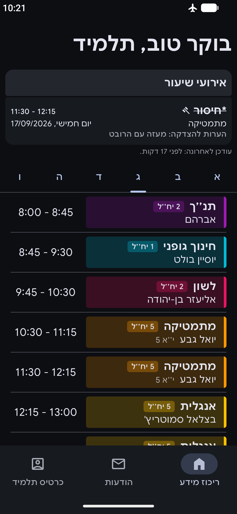
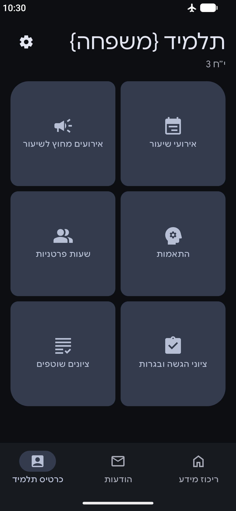
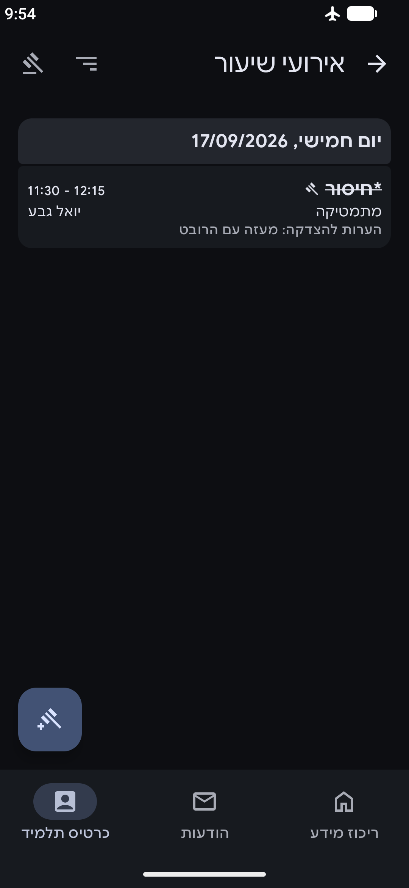
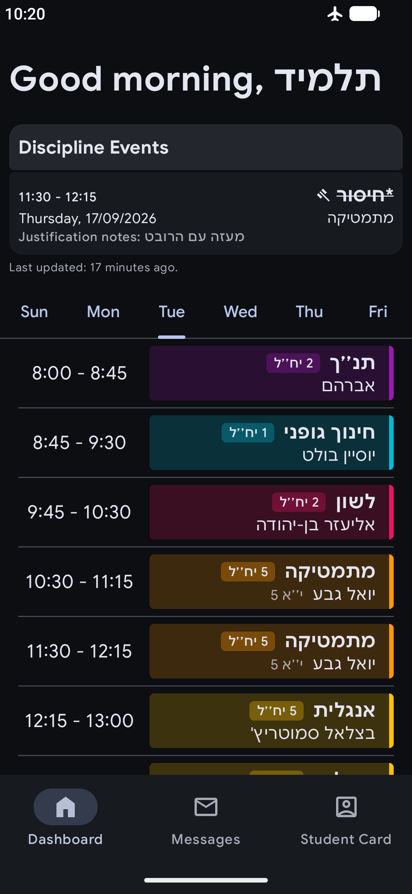
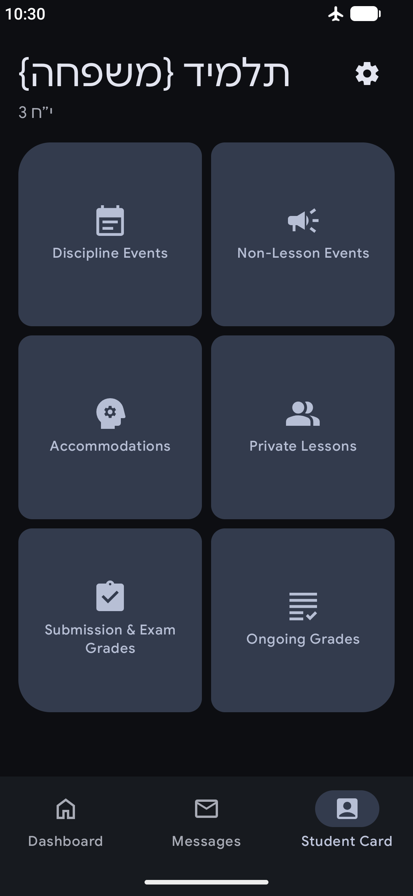
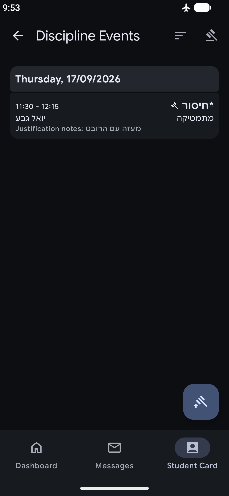

# JetTop

> [!WARNING]
> JetTop is very much unfinished. Many features don't work or don't exist at all.
> See [below](#features) for what *is* implemented.

Built with **Jet**pack Compose and Material 3 Expressive, *JetTop* is a free and open source
alternative to the [Web
**Top** Android app](https://play.google.com/store/apps/details?id=com.smartschool.webtop). It's
what the official app should have been: native, fast, and usable offline.

  <picture>
    <source media="(prefers-color-scheme: light)" srcset="docs/dashboard_he_light.png">
    
  </picture>
  <picture>
    <source media="(prefers-color-scheme: light)" srcset="docs/studentcard_he_light.png">
    
  </picture>
  <picture>
    <source media="(prefers-color-scheme: light)" srcset="docs/events_he_light.png">
    
  </picture>

  <picture>
    <source media="(prefers-color-scheme: light)" srcset="docs/dashboard_en_light.png">
    
  </picture>
  <picture>
    <source media="(prefers-color-scheme: light)" srcset="docs/studentcard_en_light.png">
    
  </picture>
  <picture>
    <source media="(prefers-color-scheme: light)" srcset="docs/events_en_light.png">
    
  </picture>

## Installation

[Download the latest build zip from GitHub Actions](https://nightly.link/doonv/JetTop/workflows/android/main/app-release.zip),
extract it, and install the extracted APK.

## Features

- Native Material 3 Expressive UI
- Support for both English and Hebrew
- Offline-first (info is cached when you're offline)
- [x] Better login
  - No Captcha required
  - No relogin required every single launch
    - Did you know they had an unused `rememberMe` flag in their login API this whole time?
- [x] Schedule
  - With identical lesson colors to official app/website
  - [ ] Rules
    - Rules allow you to modify the schedule, fixing typos, merging/removing lessons, and more.
- [x] Messages
  - [x] Details
    - [ ] Action buttons
    - [ ] Contrast fix
      - Should fix yellow highlights and such having awful contrast in dark mode.
  - [x] Downloads
  - [ ] Folders
  - [ ] Filters
  - [ ] Search
  - [ ] Multi-select
  - [ ] Compose
- [x] Student Card
  - [x] Class Events
    - [ ] Compose justifications
    - [ ] View justification requests
    - [ ] Filter/search events
  - [ ] Events outside of class
  - [ ] Private lessons
  - [ ] Grades
- [ ] Notifications
- [ ] Settings

## LLM Use

My use of LLMs for this project is very limited, as I wanted to focus on learning Jetpack Compose.
LLMs were used:

- As a teacher, teaching me how to do specific things in Compose, best practices, etc.
- To reverse engineer WebTop's obfuscated JavaScript in the places where that was needed such as
  getting the lesson colors to match and some cryptography stuff in the login request.
- Very simple refactorings, such as renames and converting hardcoded strings to localized ones.
